# Inkboard

**Handwritten notes, drawings, pages and slides — in your browser, saved on your device.**

Inkboard is a note-taking and whiteboard web app built on top of the open-source [Excalidraw](https://github.com/excalidraw/excalidraw) editor. You write and draw freely on an infinite canvas, organise the result into A4 pages or 16:9 slides, and download them as a print-ready PDF. A built-in handwriting recognizer can turn pen strokes into typed text, and you can train it on your own handwriting.

There are no accounts and no server: notes, presentations and handwriting data are stored in your browser.

**Live demo:** <https://inkboard-w.vercel.app>

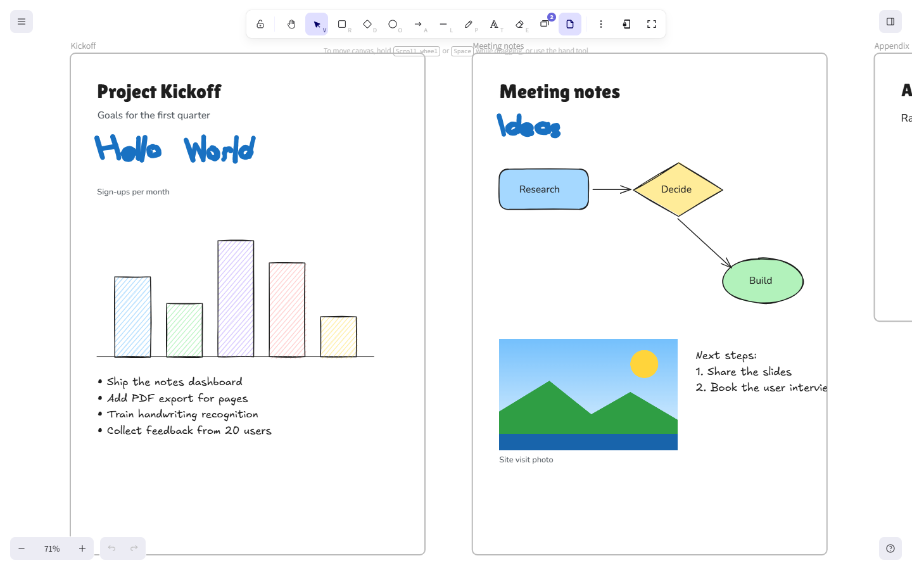

### Who it's for

- **Students** taking handwritten lecture notes with a pen or stylus and exporting them as PDF pages.
- **Anyone who thinks visually**: sketching diagrams, flowcharts and mind maps next to their notes.
- **Presenters** who want to turn a set of notes into slides, or build a simple slide deck from layouts and themes.

---

## Table of contents

- [Screenshots](#screenshots)
- [Features](#features)
- [Technology stack](#technology-stack)
- [Installation and setup](#installation-and-setup)
- [How to use Inkboard](#how-to-use-inkboard)
- [Project structure](#project-structure)
- [Data storage and privacy](#data-storage-and-privacy)
- [Known limitations](#known-limitations)
- [Troubleshooting](#troubleshooting)
- [Future improvements](#future-improvements)
- [Contributing](#contributing)
- [License](#license)

---

## Screenshots

A quick tour. More screenshots appear next to each step in [How to use Inkboard](#how-to-use-inkboard).

| Notes dashboard | Pages panel |
| --- | --- |
| 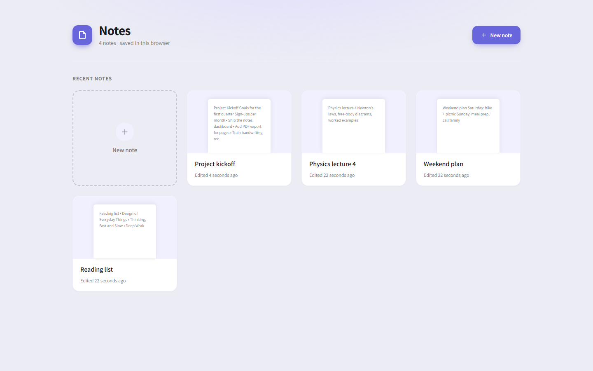 | 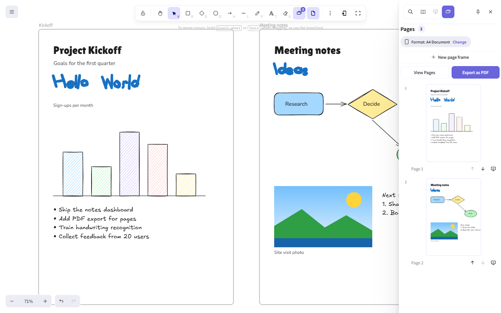 |
| All your notes, saved in the browser. | Frames become A4 pages or 16:9 slides. The preview matches the PDF. |

| Exported PDF | Presentations |
| --- | --- |
| 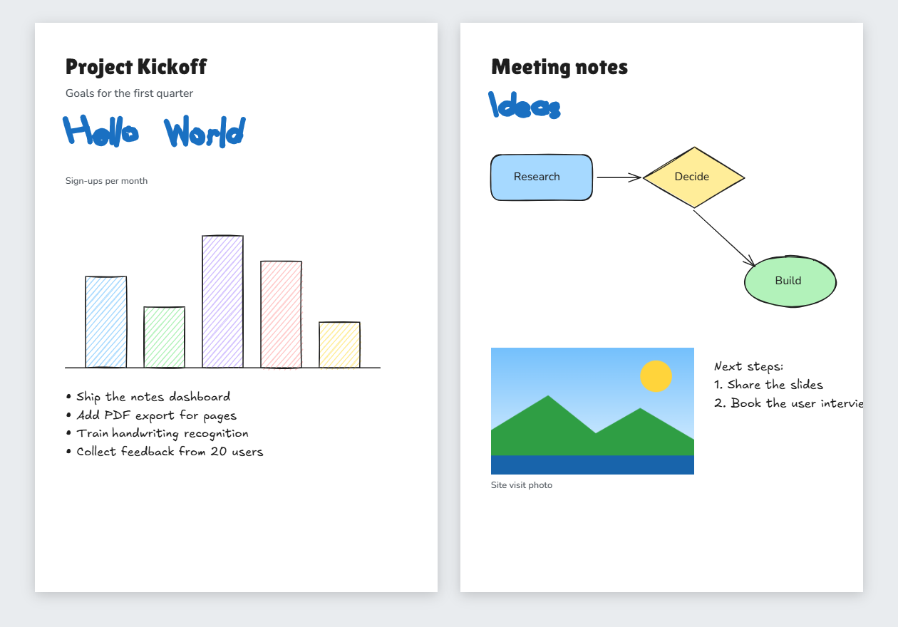 | 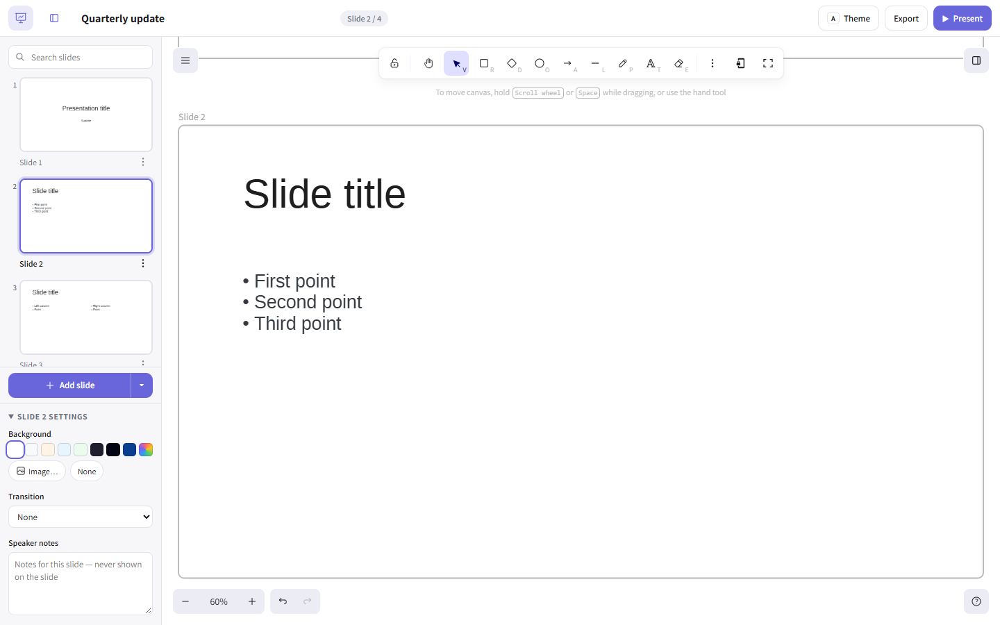 |
| A downloaded PDF (rendered with pdf.js), with the note's fonts embedded. | A separate slide editor with layouts, themes and a presenter mode. |

| Handwriting recognition | Train your handwriting |
| --- | --- |
| 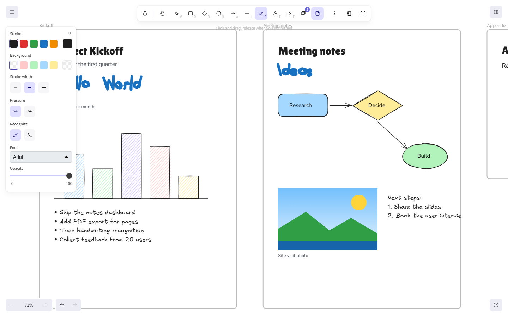 | 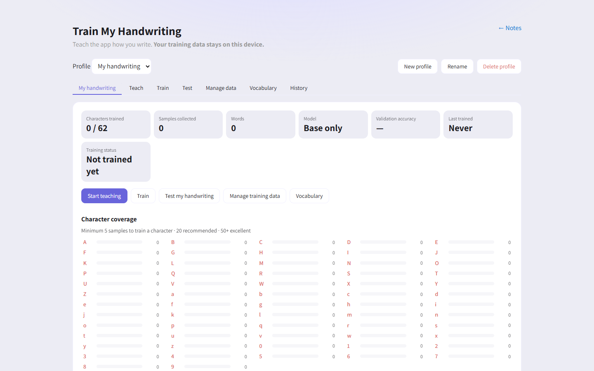 |
| The Pen's **Recognize** option turns writing into text. | Collect samples and train a personal model, in the browser. |

---

## Features

### Notes

- Create, open, rename and delete notes from the **Notes** dashboard (`/notes`).
- Each note is its own document with an automatic title and a text preview.
- Notes **save automatically** while you work.
- **Lock** a note to make it read-only, and unlock it again.

### Editor and drawing tools

Inkboard uses the Excalidraw editor, so the standard drawing tools are there:

- **Pen** (freehand drawing with pressure), **eraser**, **text**, **rectangle**, **diamond**, **ellipse**, **arrow** and **line**.
- From **More tools**: insert image, frame tool, sticky note, web embed, draw-to-shape, laser pointer, bucket fill, lasso selection, and "Mermaid to Inkboard" (turn Mermaid diagram code into a drawing).
- Styling: stroke and background colours, stroke width, opacity, fonts, text alignment, layers, grouping, alignment and image cropping.
- Undo/redo, zoom, command palette (`Ctrl+/`) and find on canvas (`Ctrl+F`).

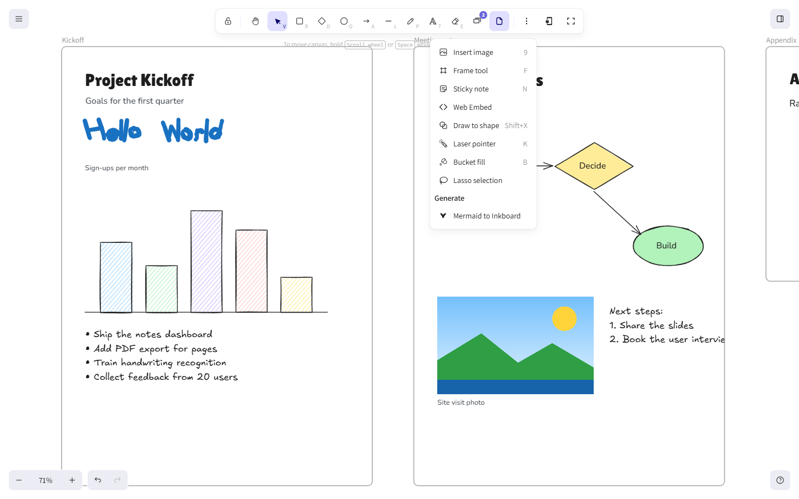

### Handwriting recognition

- The Pen tool has a **Recognize** option. When it's on, what you write is turned into text in a font you choose (Arial, Times New Roman, Georgia, Verdana, Courier New, Trebuchet MS, System UI or the hand-drawn Excalifont).
- Recognition runs **in the browser** with TensorFlow.js. It uses a small neural network trained on the EMNIST dataset that reads **62 characters**: `A–Z`, `a–z` and `0–9`.
- Low-confidence readings show suggestions. An optional vocabulary can correct near-misses of words you use often.

### Handwriting Lab (personal training)

At `/handwriting-lab` (main menu → **Train my handwriting**):

- Create **handwriting profiles** and collect character and word samples.
- **Train** a personal model in the browser. It adds a small correction layer on top of the base model, and a new version is only activated if it isn't worse than the previous one.
- **Test** recognition, manage samples, edit the vocabulary, and see the training history.
- Import and export your samples as JSON.

### Pages and slides inside a note

- Turn any **frame** into a page with **Make as Slide**, or add a correctly sized frame with **New page frame**.
- Two formats per note: **A4 Document** (portrait) or **16:9 Presentation**.
- The **Pages** panel lists the pages with live thumbnails, and lets you reorder, rename and remove them.
- **View Pages** opens a full-screen page viewer.
- Frames that don't match the format are fitted onto the page with margins ("Frame isn't A4 — fitted with margins.") and are never stretched.

### Document pages (Page view)

- **Page view** (main menu or toolbar) shows the canvas as paper pages.
- Page sizes **A4, A3, Letter and Legal**, in portrait or landscape.
- Add, duplicate and delete pages, and download them as PDF.

### PDF export

There are three ways to export a PDF:

| Where | What you get |
| --- | --- |
| **Pages panel → Export as PDF** | One page per slide/page, in A4 or 16:9 (1440 × 810 pt). |
| **Main menu → Save to… → PDF** | The whole drawing, with **Fit width**, **Actual size** or **One page** layouts on A4, A3, Letter or Legal. |
| **Page view toolbar → Download PDF** | One PDF page per document page, at its own size and orientation. |

- PDFs are **vector** files: shapes, pen strokes and images stay sharp, and image crops are kept.
- The note's own font files (Excalifont, Nunito, Lilita One, Comic Shanns and the other bundled fonts) are **embedded** in PDFs exported from the Pages panel or the Page view toolbar. Page previews use exactly the same rendering as the PDF.

### Presentations

A separate slide-deck editor at `/presentations`:

- Create presentations with a slide size, orientation and theme (Minimal, Dark, Light, Professional, Creative).
- Slide layouts: Blank, Title, Title + Content, Two Columns, Image + Text and Section Header.
- Per-slide background (colour or image), transitions (none, fade, slide, zoom) and **speaker notes**.
- **Present** full screen, with a presenter view that shows your notes.
- Export to **PDF**, or to a `.json` file that can be imported again.

### Saving and files

- **Save to disk** writes the note to an `.inkboard` file that you can open again later, with everything still editable.
- **Export image…** saves PNG or SVG images.
- **Open** loads a saved file.

### Interface

- Light, dark and system themes, and many interface languages.
- Full-screen mode.
- Works on phones and tablets, with a touch toolbar at the bottom. **Pen mode** ignores finger touches so a stylus can write while your hand rests on the screen.
- An installable Progressive Web App (PWA) in production builds.

---

## Technology stack

| Area | Technology |
| --- | --- |
| Language | TypeScript |
| UI | React 19 |
| Drawing | Rough.js (hand-drawn shapes), perfect-freehand (pen strokes) |
| State | Jotai |
| Styling | SCSS |
| Build and dev server | Vite 5, vite-plugin-pwa |
| Handwriting recognition | TensorFlow.js 4 (CNN model in `public/models/`) |
| PDF | jsPDF + svg2pdf.js (vector pages), pdf-lib (whole-drawing export) |
| Fonts in PDF | HarfBuzz/WOFF2 WebAssembly (bundled with the editor) for font decoding |
| Storage | IndexedDB (via idb-keyval) and localStorage |
| Tests | Vitest, Testing Library, jsdom |
| Package manager | Yarn 1 (workspaces) |
| Model training (optional) | Python, PyTorch, NumPy (`scripts/handwriting-model/`) |
| Deployment | Vercel (`vercel.json`) or Docker + nginx (`Dockerfile`) |

---

## How to use Inkboard

### 1. Create a note

1. Open **Notes**: go to `/notes`, or choose **Notes** in the main menu (☰, top left).
2. Click **New note**. The note opens in the editor.
3. To rename or delete a note, use the buttons on its card in the dashboard.


### 2. Write and draw

1. Pick a tool from the toolbar at the top: Pen (`P`), shapes, arrow, line, text (`T`) or eraser (`E`).
2. Open **More tools** (⋮) for images, frames, sticky notes, the laser pointer and more.
3. Select something to change its colour, stroke, font or opacity in the panel on the left.

Your note saves automatically. There's no save button to press.

### 3. Turn handwriting into text

1. Select the **Pen** (`P`).
2. In the Pen panel, under **Recognize**, choose the text option (the "A" with a squiggle) and pick a **Font**.
3. Write a word, leaving small gaps between letters. When you stop writing, the strokes are replaced by typed text.
4. If a reading is wrong, double-click the text to fix it. Corrections can be saved as training samples.


### 4. Make pages or slides from frames

1. Draw a **frame** (More tools → **Frame tool**, or `F`) around the content you want on one page.
2. Select the frame and click **Make as Slide** (the monitor-with-plus icon under **Actions**).
3. The first time, choose a size: **A4 Document** or **16:9 Presentation**. All pages in a note use the same size.
4. If the frame's shape doesn't match, choose **Fit Content** (reshape the frame around its content) or **Keep Frame Ratio** (keep the frame and fit it onto the page with margins).

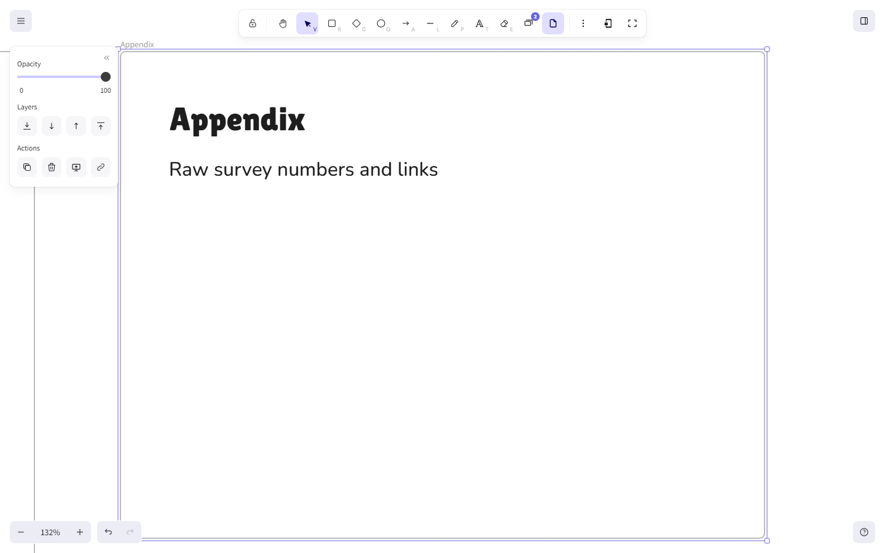

### 5. Manage pages, preview and export a PDF

1. Open the **Pages** panel: use the slides icon in the toolbar (it shows the page count), or main menu → **Slides**.
2. Use **New page frame** to add a page of the right size, the arrows to reorder pages, and **Change** to switch between A4 and 16:9.
3. Click **View Pages** for a full-screen preview (use ← / → to move between pages).
4. Click **Export as PDF** to download one PDF page per slide.


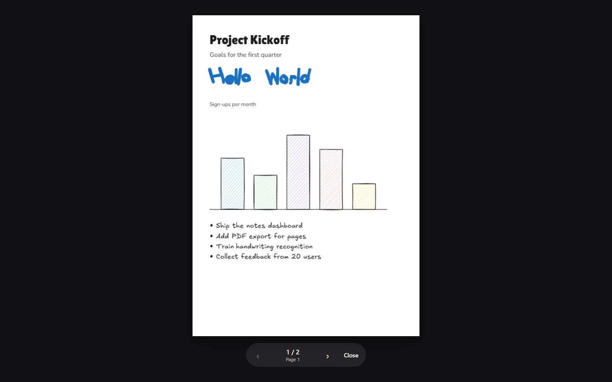

The downloaded PDF matches the previews:


### 6. Use Page view for document pages

1. Click the page icon in the toolbar, or main menu → **Page view**.
2. Choose a **Page size** (A4, A3, Letter, Legal) and **Orientation**.
3. Use **Add page**, **Duplicate page**, **Delete page** and **Download PDF**.


### 7. Save, export and settings

Open the main menu (☰) to:

- **Open** a saved `.inkboard` file, or **Save to…** a file or a PDF.
- **Export image…** as PNG or SVG.
- **Lock document**, switch to **Full Screen**, or open **Notes**, **Presentations** or **Train my handwriting**.
- Change the **Theme**, **language** and **canvas background**.

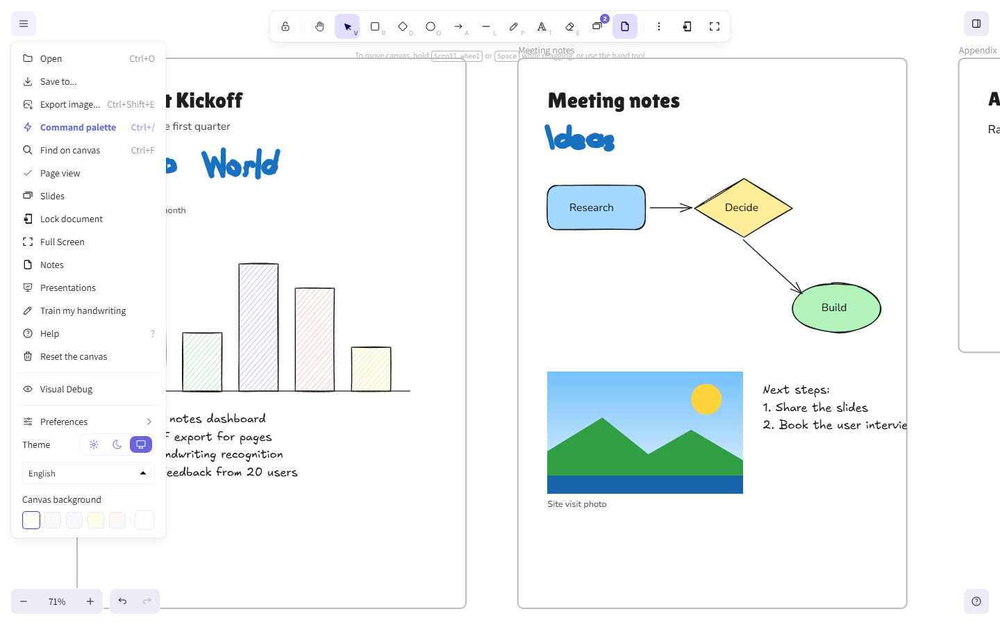

**Save to…** offers a file (fully editable) or a PDF with layout and paper options:

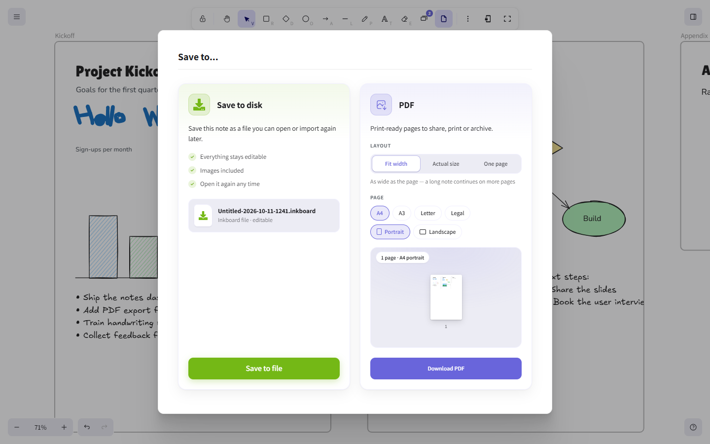

### 8. Build a presentation

1. Go to `/presentations` (main menu → **Presentations**) and click **New presentation**. Choose a name, slide size, orientation and theme.
2. Add slides with **Add slide**, or use the arrow next to it to pick a layout.
3. Set each slide's background, transition and speaker notes in the left panel.
4. Click **Present** to show it full screen. **Export** saves a PDF or a `.json` file.

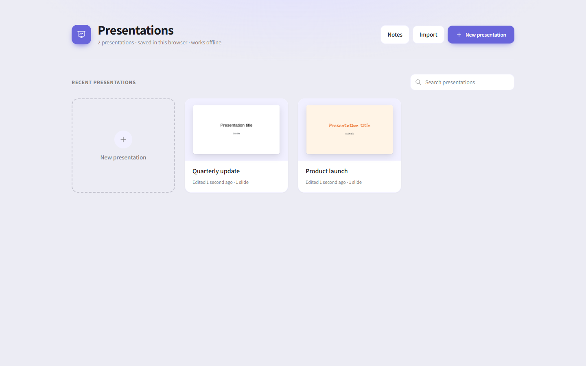

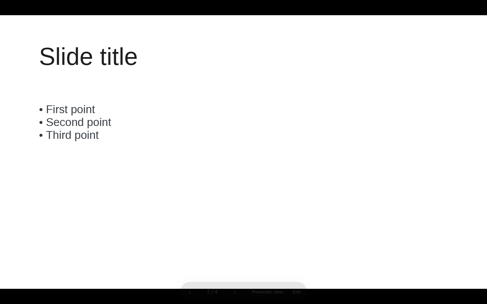

### 9. Train recognition on your handwriting

1. Open main menu → **Train my handwriting** (or `/handwriting-lab`).
2. **Teach**: write each character (and some words) to collect samples. Aim for 20 or more samples per character.
3. **Train**: train your personal model in the browser.
4. **Test**: try it out. Recognition in the editor now uses your model.

Advanced users can also retrain the base model offline with Python; see [`scripts/handwriting-model/README.md`](scripts/handwriting-model/README.md).

### On a phone or tablet

The toolbar moves to the bottom of the screen and works with touch and stylus input:

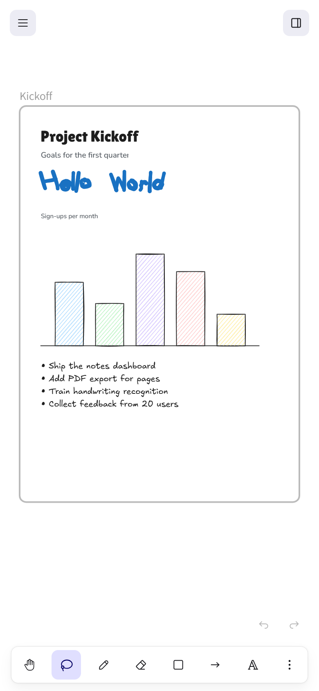

---

## Project structure

```text
.
├── Inkboard/                    # The Inkboard web app (Vite)
│   ├── App.tsx                  # App shell: routes, autosave, menus
│   ├── components/
│   │   ├── NotesHome.tsx        # Notes dashboard
│   │   ├── ExportToPDF.tsx      # "Save to… → PDF" card
│   │   ├── pages/               # Page view toolbar, page PDF export, PDF fonts
│   │   └── handwriting-lab/     # Handwriting Lab screens
│   ├── noteSlides/              # Pages/slides inside a note (panel, viewer, rendering)
│   ├── presentation/            # Presentations dashboard, editor and presenter
│   ├── handwriting/             # Recognition engine, personal training, profiles
│   ├── data/                    # Local storage: notes, presentations, files
│   └── vite.config.mts
├── packages/                    # Editor packages
│   ├── Inkboard/                # The React editor component
│   ├── element/                 # Element model, frames, pages
│   ├── common/                  # Shared constants and utilities
│   ├── math/  utils/  …         # Geometry and helpers
├── public/                      # Static assets, incl. the handwriting model (public/models/)
├── scripts/
│   └── handwriting-model/       # Optional Python training for the recognition model
├── readme-screenshot/           # Screenshots used in this README
├── examples/                    # Upstream integration examples
├── Dockerfile                   # Production image (nginx)
├── vercel.json                  # Vercel deployment settings
└── package.json                 # Yarn workspaces and scripts
```

---

## Data storage and privacy

Inkboard is a static web app. It has **no backend and no accounts**, and it doesn't upload your notes anywhere. Everything is stored **in your browser, on your device**:

| Data | Where |
| --- | --- |
| Notes (content and titles) | IndexedDB |
| Images in notes | IndexedDB |
| Presentations | IndexedDB |
| Handwriting profiles, samples, personal models and training history | IndexedDB |
| Freeform board at `/`, preferences (theme, language, fonts, slide size) | localStorage |

What this means for you:

- **Your data stays on this browser and this device.** It isn't synced to other devices or browsers.
- **There is no automatic backup.** Clearing your browser's site data, or using a private window, deletes your notes. Use **Save to… → Save to file** to keep a copy.
- Data isn't encrypted by Inkboard. It is protected only by your browser and operating-system account.
- Web content you embed with **Web Embed** is loaded from its own website.
- The production build has analytics turned off (`VITE_APP_ENABLE_TRACKING=false`).

---

## Known limitations

- **Handwriting recognition** reads only the 62 characters `A–Z`, `a–z` and `0–9`, with no punctuation and no non-Latin scripts. It works best with printed letters written with small gaps between them.
- **Fonts installed on your computer** (Arial, Georgia, Verdana and so on) can't be embedded in a PDF by a web page. Text in these fonts, emoji and right-to-left text are placed in the PDF as high-resolution images: they look the same, but you can't select them.
- In PDFs, letter spacing follows the font's standard widths (no kerning or ligatures), so it can differ very slightly from the editor.
- Notes support exactly two page formats: **A4** and **16:9**.
- Full screen isn't available in browsers that don't support it (for example Safari on iPhone).

---

## Troubleshooting

| Problem | Solution |
| --- | --- |
| `yarn: command not found` | Install Yarn 1: `npm install --global yarn`. |
| Install fails or Node version errors | Use Node.js 18 or newer (`node --version`). |
| Port 3001 is already in use | Stop the other process, or set `VITE_APP_PORT` in a new `.env.development.local` file. |
| My notes disappeared | Notes live in the browser you created them in. Check that you're using the same browser and profile, and not a private window. Clearing site data deletes them for good. |
| "Handwriting recognition couldn't load" | Reload the page. The model is loaded from `public/models/` the first time you turn Recognize on. |
| Recognition gives the wrong letters | Leave small gaps between letters, write larger, or train your handwriting in the Handwriting Lab. |
| Text in the PDF can't be selected | It uses a font installed on your computer (e.g. Georgia), or contains emoji/RTL text. Use a bundled font (Excalifont, Nunito, …) for selectable text. |
| PDF warning about a font | The font couldn't be loaded or embedded. Check your connection and export again. |
| Page thumbnails look out of date | They refresh shortly after each change. Close and reopen the Pages panel if needed. |

---

## Future improvements

Ideas for future work. **None of these are implemented, and they're not commitments:**

- Optional sync or backup across devices.
- Recognition of punctuation and more alphabets.
- Selectable text in PDFs for fonts installed on the computer (for example via the browser's Local Font Access API).

---

### Acknowledgements

- [Excalidraw](https://github.com/excalidraw/excalidraw), the editor Inkboard is built on.
- [EMNIST](https://www.nist.gov/itl/products-and-services/emnist-dataset), the handwriting dataset used to train the base recognition model.
